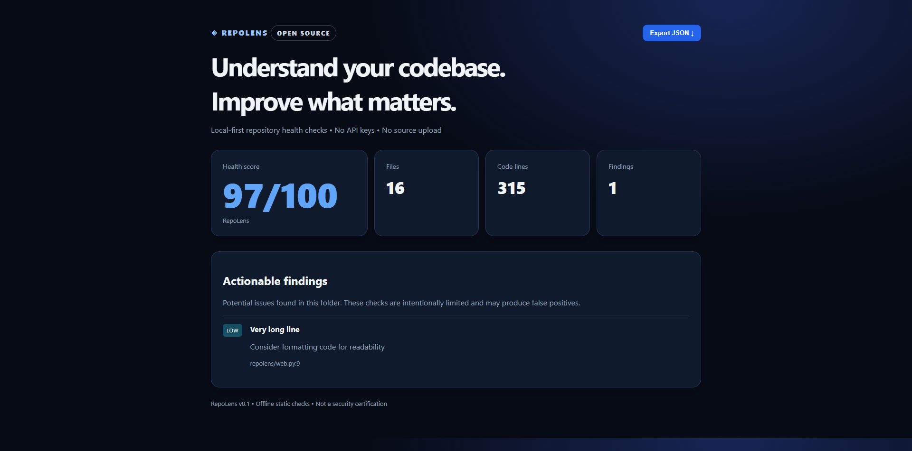

# ◈ RepoLens

**Local-first repository health analyzer with a dashboard, CLI, JSON exports, and CI.**

RepoLens scans a local code directory for common repository hygiene issues, selected hardcoded credential patterns, and very long lines. It generates a heuristic health score and actionable findings. **No source files are uploaded**; the dashboard binds to `127.0.0.1`.

> [!IMPORTANT]
> This is an early-stage heuristic scanner, not a complete security audit. It can miss vulnerabilities and create false positives. Do not treat its score as proof of safety.

## Features

- Zero runtime dependencies (Python 3.10+)
- Local browser dashboard
- CLI mode for terminals and automation
- JSON output for CI integrations
- Basic leaked-secret indicators with **no secret values in reports**
- README, license, .gitignore, tests, and GitHub Actions checks

## Install

```bash
git clone https://github.com/subsguy10-dotcom/repolens.git
cd repolens
python -m venv .venv
# macOS/Linux:
source .venv/bin/activate
# Windows PowerShell instead:
# .\.venv\Scripts\Activate.ps1
python -m pip install .
repolens .
repolens-web .
```

Python 3.10+ required. Runtime uses only the standard library; installation downloads setuptools from PyPI. If PowerShell activation is restricted, run `.\.venv\Scripts\python -m repolens.cli .` directly.

## Dashboard



Start `repolens-web /path/to/repository`, then open <http://127.0.0.1:8765>. Dashboard shows file counts, nonblank code lines, health score, findings, and incomplete-scan warnings. **Export JSON** downloads the current displayed report. Reload to rescan. Use `--port 8766` if the default port is occupied.

## Run in seconds

```bash
# From the project root — no installation required
python -m repolens.cli .

# Open the dashboard
python -m repolens.web .
# Visit http://127.0.0.1:8765

# Analyze a different folder
python -m repolens.cli /path/to/your/repository --json

# CI threshold (exit 1 if below 70)
python -m repolens.cli . --min-score 70
```

On Windows PowerShell, `py -m repolens.web .` also works when Python is installed via the standard Windows launcher.

## Run tests

```bash
python -m unittest discover -s tests -v
```

## JSON and CI

```bash
repolens . --json > report.json
repolens . --min-score 70
```

JSON includes `name`, `score`, `files`, `scanned_text_files`, `lines_of_code`, `findings`, `warnings`, `truncated`, and `skipped_text_files`. Findings include severity, title, recommendation, and optional relative file/line. Reports omit matched credential values. Review filenames before sharing reports.

Score starts at 100: each high finding subtracts 20, medium 8, low 3; minimum 0. Missing root README/license/gitignore/tests each costs 8; missing workflow or long code line costs 3. Repeated secrets produce separate findings. Exit status: 0 meets threshold; 1 below threshold; 2 invalid input. A high score cannot certify security; inspect warnings and skipped files.

## Limitations

- Analyzes local folders, including cloned GitHub repositories. It does not fetch GitHub repositories, issues, pull requests, or remote metadata.
- Pattern checks cover selected private keys, AWS identifiers, GitHub tokens, and quoted credential assignments. No dependency vulnerability analysis, entropy detection, history scan, or complete language parsing.
- UTF-8 text only, up to 512,000 bytes per file and 3,000 files. Skips dependency/build folders and symlinks; Windows junctions skipped on Python 3.12+. Scans are bounded snapshots, not safe against concurrent hostile filesystem changes.
- Ignores `.gitignore` rules when scanning; `.env` files are intentionally checked. A present `.env` is flagged even when gitignored. Root hygiene checks apply to project root; tests/workflows detected heuristically.
- No authentication: dashboard binds IPv4 loopback only and rejects unexpected Host headers. Use only on trusted local machines; do not proxy it publicly.
- Large/minified code and synthetic test credentials can cause false positives. Files skipped or limits reached appear in warnings; score still describes only analyzed files.

## Roadmap

1. Improve secret detection with entropy checks and safe allowlists.
2. Add incremental scans and language-specific plugins.
3. Add SARIF output for GitHub code scanning.
4. Add a machine-readable rule configuration and documented scoring rubric.
5. Expand browser accessibility and language-specific test coverage.

## Security and privacy

The tool reads local files only. It skips symlinks and common dependency/build directories, caps files at 3,000 and text files at 512 KB, and avoids printing detected credential values. Users should not run it against folders they are not authorized to inspect.

## Contributing

Issues and pull requests are welcome. Please include reproducible test cases for new detection rules, and **never post actual tokens or passwords**.

## License

MIT — see [LICENSE](LICENSE).
